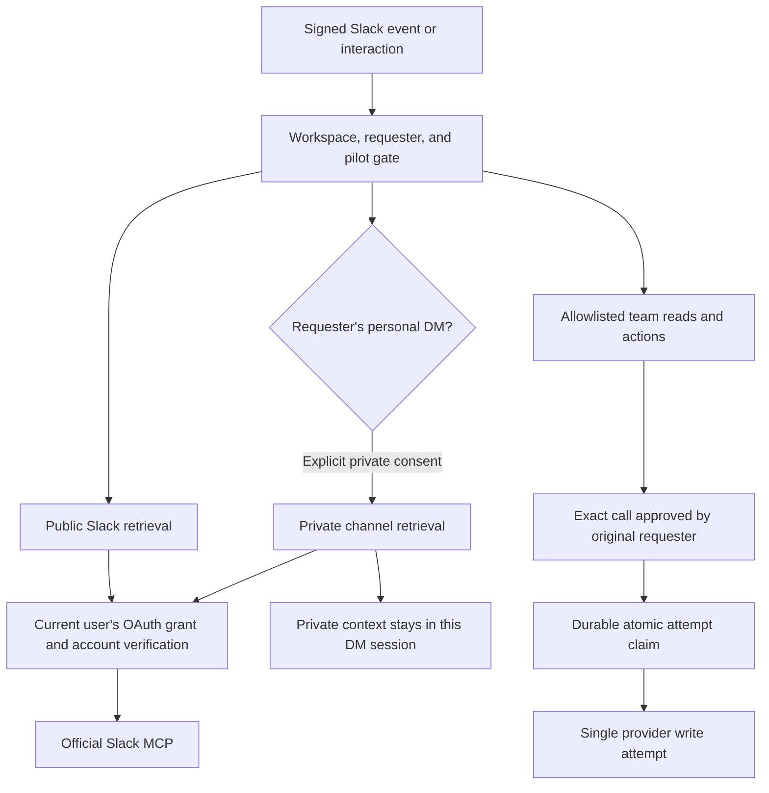

# First-release operator checklist

Do not enable broader access until this checklist passes with two V1 users.
Use the complete stack in a controlled deployment. No production deployment,
OAuth pilot, or broader rollout has been verified by the local test suite.

## Architecture



AgentMail draft preparation bypasses approval, but still requires the durable
attempt claim. Existing organizational credentials remain centralized.

## Configure before the pilot

- [ ] Select two actual V1 Slack users. Prefer users who do not share at least
  one private test channel. They must each complete their own consent.
- [ ] Choose a public test thread and separate personal DMs with Vee. Use
  synthetic, non-sensitive markers for private isolation tests.
- [ ] Set `VEE_SLACK_ROLLOUT=pilot` and `VEE_SLACK_PILOT_USERS=UA,UB`, replacing
  the example IDs. The default empty allowlist admits nobody.
- [ ] Confirm the linked Vercel project, environment, and V1 workspace. The local
  operator must have fresh Vercel credentials. Do not infer production setup
  from a local environment file or a browser login.
- [ ] Preserve the bot connector `slack/v1-ops` and its reply identity.
- [ ] Configure Slack MCP access on the app behind `SLACK_SEARCH_CONNECTOR`
  (default `slack/vee`). Confirm the official MCP app setting is enabled and the
  connector can request the scopes below. Follow the [Slack MCP documentation](https://docs.slack.dev/ai/slack-mcp-server/).

| Consent | User scopes |
| --- | --- |
| Initial public access | `search:read.public`, `channels:read`, `channels:history` |
| Additional private access | Public scopes plus `search:read.private`, `groups:read`, `groups:history` |

Do not add `search:read.im`, `search:read.mpim`, `im:*`, or `mpim:*` user scopes.
Bot scopes for replying and handling its current conversation are separate.
The runtime checks actual channel type before channel/thread reads. It fixes
private search to `channel_types=private_channel` and refuses a server without
that parameter.

- [ ] Keep the old shared Slack grant in Connect for operator recovery. Do not
  revoke it during the pilot or add an automatic fallback to it.
- [ ] Provision existing designated shared accounts for Notion, Granola,
  Calendar, and AgentMail. Keep their subject IDs unchanged. GitHub remains the
  installation for `V1Michigan/vee` and `V1Michigan/website-v2`.
- [ ] Exclude `notion-ai-search` in the shared Notion connection's server-side
  tool configuration. A client allowlist alone cannot prevent ordinary Notion
  search from routing to connected sources. See [Notion's routing rules](https://developers.notion.com/guides/mcp/mcp-supported-tools).
- [ ] Provision Calendar's connector and enable the required Google APIs before
  OAuth. Authorize only designated V1 accounts whose data can be shared.
- [ ] Configure `VEE_ACTION_REDIS_REST_URL` and `VEE_ACTION_REDIS_REST_TOKEN` on
  the deployment. Use a durable Redis REST store with atomic `SET NX`, such as
  [Upstash's REST API](https://upstash.com/docs/redis/features/restapi). Use the
  same journal for all workers and deployments that can resume these sessions.
- [ ] Disable eviction. Never expire/delete write-attempt keys while workflows
  can resume. Restoring an older journal snapshot can allow duplicate dispatch.
  Journal data is a hashed call key and argument digest, not provider content.

Missing journal configuration blocks writes, including draft creation, before
the provider call. A lost reply to a journal claim also blocks dispatch. Once
claimed, a call stays claimed even after a timeout or failed provider response.
Check the destination before proposing a fresh call. No automatic retry can
prove that an interrupted write did not already commit.

## Automated verification

```bash
pnpm test
pnpm typecheck
pnpm build
pnpm connections:check
pnpm connections:check slack-search --slack-user UA
pnpm connections:check slack-search --slack-user UB
```

Replace UA and UB with the actual IDs. All connection probes are read-only and
make no model calls. They never request the old shared Slack grant.

| Diagnostic stage | What success proves |
| --- | --- |
| Credential | Connect returned a bearer for the configured subject and scopes |
| Identity | Slack `auth.test` matched the requesting account and workspace |
| MCP | The provider completed MCP initialization |
| Retrieval | An allowed provider read completed successfully, possibly with zero results |

Provider configuration, authorization required/declined, wrong account, missing
scope, rate limits, and outages have separate codes. Fix the reported stage and
run the relevant check again. A cached browser login does not provision Connect.
Diagnostics print no tokens, callback URLs, source text, or raw errors.

Local tests exercise mocked OAuth and real MCP client transports. They cover
scope boundaries, independent users, account mismatches, declined/revoked
authorization, resume, integration messages, citation preservation, incomplete
results, approval denial, changed arguments, another approver, and crash replay.
They do not prove the live Slack app configuration or consent UI works.

## Live pilot matrix

Record pass/fail, deployment SHA, tester, and a restricted evidence link for
each row. Do not copy private test content into a public issue or diagnostic log.

| Check | Required result | Status |
| --- | --- | --- |
| A and B in one public thread | Each receives their own sign-in flow and uses their own account | Pending |
| Wrong Slack account during consent | No retrieval, clear mismatch, reconnect with correct account succeeds | Pending |
| Declined consent | Clear denial, no loop, no shared fallback | Pending |
| Revoked user grant | Retrieval stops and personal authorization can resume | Pending |
| Private opt-in in A's DM | Extra consent appears only there and a known private marker is found | Pending |
| Public thread after A grants private access | Private search and direct private channel/thread reads remain blocked | Pending |
| B's DM and group DM | A's private context is unavailable; group DM private search is blocked | Pending |
| Personal DM search/read | Blocked for A and B, including arbitrary channel IDs and filters | Pending |
| Private export attempt | Other provider queries/actions and public URL fetches are blocked in that session | Pending |
| Tally discovery | A known public Tally confirmation is returned and its permalink opens for the tester | Pending |
| Search completeness | Pagination and partial coverage are stated; no unsupported claim to list all records | Pending |
| Source selection | Slack-only questions avoid mandatory Notion calls; relevant meetings/docs use the correct source | Pending |
| Denied action | No provider write | Pending |
| B clicks A's approval | Execution denied; no provider write | Pending |
| Changed arguments | Original binding is rejected; fresh proposal requests fresh approval | Pending |
| Large code or email action | Full content appears before approval buttons | Pending |
| Journal unavailable | No provider write | Pending |
| Interrupted write in a controlled test | Unknown outcome reported; same call cannot dispatch again after restart | Pending |
| Shared providers | Both users can retrieve approved organizational data without personal service OAuth | Pending |
| Metrics | One turn report, correct counters/timings, no credentials or source content | Pending |
| Non-pilot user | Inbound work and guarded tools are unavailable | Pending |

Use reversible test actions and approve their exact destinations and contents.
No live mutations were performed by the implementation's diagnostic commands.

## Enable and recover

- [ ] All automated checks and pilot rows passed on the complete stack.
- [ ] Review per-turn usage and failure rates from representative tasks. The
  model is unchanged. Do not claim cost savings without measured evidence.
- [ ] Merge stacked PRs in order and validate the cumulative deployment SHA.
- [ ] Cancel parked approvals and auth flows from older deployments. Start fresh
  pilot conversations so old shared-auth history cannot masquerade as evidence
  for the new isolation rules.
- [ ] Only then set `VEE_SLACK_ROLLOUT=enabled` for broader rollout.

For an incident, set `VEE_SLACK_ROLLOUT=disabled`, cancel active/parked workflows,
and inspect the safe failure codes. A guard cannot recall a provider write that
was already dispatched. Keep the journal and grants intact while investigating.
Prefer rolling back a faulty feature while retaining access checks. Restoring
an old shared-auth deployment changes the privacy model and requires explicit
operator review. The retained shared grant is recovery material, never a runtime
fallback for a failed personal authorization.

## Current evidence

As of September 29, 2026, all 46 tests, typecheck, and the complete-stack build
passed through the project's pnpm commands.
GitHub's live credential, MCP handshake, and repository read passed. The existing
Notion, Granola, and AgentMail subjects required authorization. Calendar's
connector was not found. The checked user's per-user Slack grant required
authorization. Journal credentials were not present locally. The live matrix
above remains pending. No broader rollout is enabled by default.
